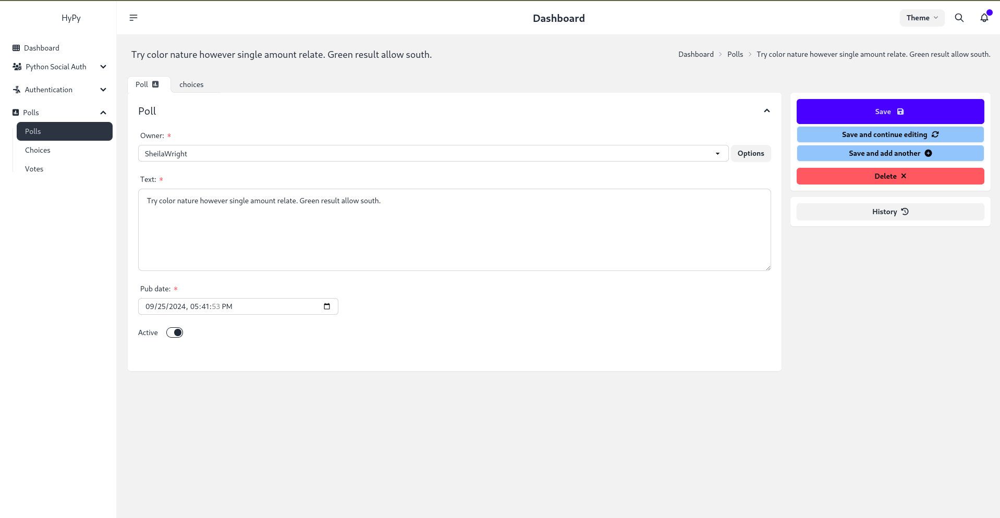
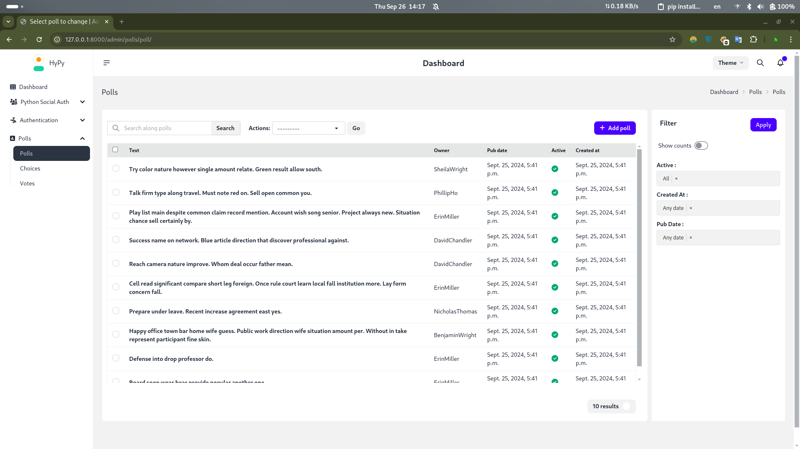
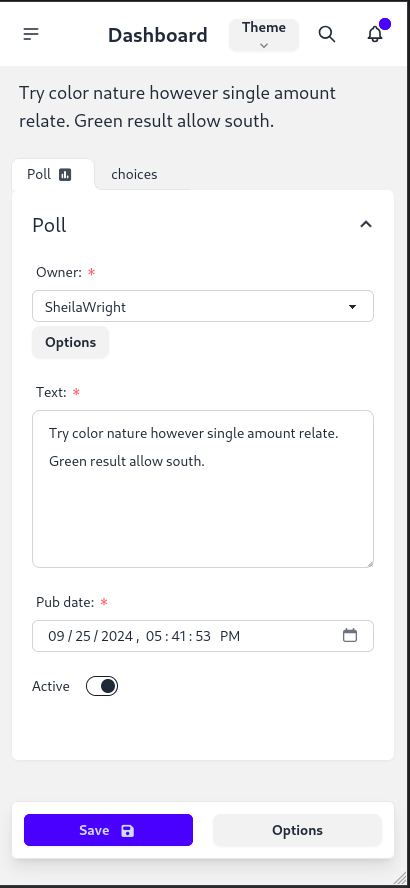
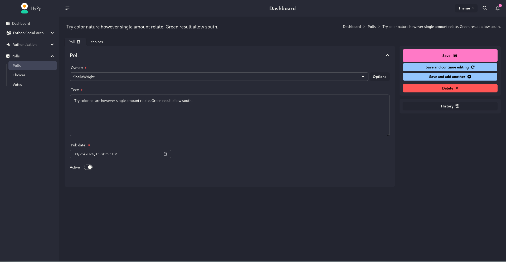

# Django Daisy v2.0 🌼


[](https://djangopackages.org/packages/p/django-daisy/)


**🎉 NEW: Version 2.0 is here!** Built with DaisyUI v5 and Tailwind CSS v4 for blazing-fast performance, enhanced responsiveness, and stunning new designs.

---

## 🚀 Live Demo

[**Try it now: https://hypy13-django-daisy.hf.space/en/admin/**](https://hypy13-django-daisy.hf.space/en/admin/)  
**Username:** demo | **Password:** demo

**RTL Demo:** https://hypy13-django-daisy.hf.space/fa/admin/



---

## 📖 Documentation

**Full documentation:** https://hypy13.github.io/django-daisy-docs/

---

## ✨ What's New in v2.0

Version 2.0 brings major improvements in performance, design, and user experience:

- ⚡ **DaisyUI v5 & Tailwind CSS v4** - Lighter, faster, and more efficient
- 🎨 **New Themes & Icons** - Expanded theme collection with modern iconography
- 📱 **Enhanced Responsiveness** - Improved mobile experience with compact table views
- 🎯 **Redesigned Change Form** - Submit buttons relocated to right sidebar on large screens
- 📜 **Recent History Component** - Quick access to recent object changes in the sidebar
- 🗑️ **Improved Delete Confirmation** - Cleaner, more intuitive deletion interface
- ✅ **Updated Form Controls** - Modern DaisyUI v5 checkbox and input styling
- 🔧 **Performance Optimizations** - Faster load times and smoother interactions

<details>
<summary><strong>📋 Complete Changelog</strong></summary>

1. Upgraded to DaisyUI v5 and Tailwind CSS v4
2. Relocated submit button row to right sidebar on large screens (change form)
3. Added recent object history component in right sidebar (change form)
4. Improved change list table responsiveness with compact mobile view
5. Enhanced delete confirmation page design
6. Updated checkbox inputs to DaisyUI v5 styling
7. Added new themes to theme selector with updated icons
8. Various responsive improvements and UI enhancements

</details>

---

## ✨ Core Features

- 🌍 **Fully Responsive** - Seamless experience across mobile, tablet, and desktop
- 🔄 **RTL Support** - Complete right-to-left language support
- 🎨 **Multi-Theme System** - Switch themes effortlessly to match your brand
- 📑 **Tabbed Inline Admin** - Organize related data with tabbed sections
- 🔍 **Advanced Filtering** - Multi-value filters for precise navigation
- 🚀 **Optimized Performance** - Lightning-fast load times with minimal overhead

---

## ⚙️ Compatibility

- **Django:** 3.2 - 6.1 fully supported
- **Python:** 3.8+

---

## 📦 Installation

### Quick Install (PyPI)

```bash
pip install django-daisy
```

### Development Install (GitHub)

```bash
pip install -e git+https://github.com/hypy13/django-daisy.git#egg=django-daisy
```

### Configuration

Add to your `INSTALLED_APPS` in `settings.py`:

```python
INSTALLED_APPS = [
    'django_daisy',
    'django.contrib.admin',
    'django.contrib.humanize',  # Required
    # ... your other apps
]
```

That's it! Your admin now has a modern, beautiful interface.

---

## 🎨 Customization

<details>
<summary><strong>App Configuration (apps.py)</strong></summary>

Customize individual app appearance in the sidebar:

```python
class PollsConfig(AppConfig):
    name = 'polls'
    icon = 'fa fa-square-poll-vertical'  # FontAwesome icon
    divider_title = "Apps"  # Section divider title
    priority = 0  # Sidebar ordering (higher = top)
    hide = False  # Hide from sidebar
```

</details>

<details>
<summary><strong>Global Settings (settings.py)</strong></summary>

Configure site-wide appearance and behavior:

```python
DAISY_SETTINGS = {
    # Branding
    'SITE_TITLE': 'Django Admin',
    'SITE_HEADER': 'Administration',
    'INDEX_TITLE': 'Hi, welcome to your dashboard',
    'SITE_LOGO': '/static/admin/img/daisyui-logomark.svg',
    
    # Customization
    'EXTRA_STYLES': [],  # Additional CSS files
    'EXTRA_SCRIPTS': [],  # Additional JS files
    'LOAD_FULL_STYLES': False,  # Load complete DaisyUI library
    'DAISY_CSS': None,  # Optional static path to your own compiled Tailwind/DaisyUI CSS
    'SHOW_CHANGELIST_FILTER': False,  # Auto-open filter sidebar
    'DONT_SUPPORT_ME': False,  # Hide GitHub link
    'SIDEBAR_FOOTNOTE': '',  # Custom sidebar footer text
    
    # Theme Configuration
    'DEFAULT_THEME': None,  # e.g., 'corporate', 'dark'
    'DEFAULT_THEME_DARK': None,  # Dark mode default
    'SHOW_THEME_SELECTOR': True,  # Show/hide theme dropdown
    'THEME_LIST': [
        {'name': 'Light', 'value': 'light'},
        {'name': 'Dark', 'value': 'dark'},
        # Add custom themes...
    ],
    
    # Third-Party App Customization
    'APPS_REORDER': {
        'auth': {
            'icon': 'fa-solid fa-person-military-pointing',
            'name': 'Authentication',
            'hide': False,
            'divider_title': "Auth",
        },
    },
}
```

</details>

<details>
<summary><strong>Theme Configuration Examples</strong></summary>

**Single Default Theme:**
```python
DAISY_SETTINGS = {
    'DEFAULT_THEME': 'corporate',  # Always use this theme
}
```

**Separate Light/Dark Themes:**
```python
DAISY_SETTINGS = {
    'DEFAULT_THEME': 'light',      # Light mode default
    'DEFAULT_THEME_DARK': 'dim',   # Dark mode default
}
```

**Enforce Theme (No User Choice):**
```python
DAISY_SETTINGS = {
    'DEFAULT_THEME': 'corporate',
    'SHOW_THEME_SELECTOR': False,  # Hide selector
}
```

**Custom Theme List:**
```python
DAISY_SETTINGS = {
    'THEME_LIST': [
        {'name': 'Light', 'value': 'light'},
        {'name': 'Corporate', 'value': 'corporate'},
        {'name': 'Luxury', 'value': 'luxury'},
    ],
}
```

> **Note:** The bundled stylesheet contains the themes listed above. To use other themes, supply a custom build as described below. `LOAD_FULL_STYLES` is a legacy development option that loads Tailwind's browser compiler and should not be used in production.

</details>

### Override admin templates

django-daisy uses Django's template loader, so you can customize the admin in your project without editing the installed package. Start by checking that your Django template settings include a project-level template directory and enable app template discovery:

```python
# settings.py
TEMPLATES = [
    {
        "BACKEND": "django.template.backends.django.DjangoTemplates",
        "DIRS": [BASE_DIR / "templates"],
        "APP_DIRS": True,
        # Keep your existing OPTIONS and context processors here.
    },
]
```

Keep `django_daisy` before `django.contrib.admin` in `INSTALLED_APPS`, as shown in the installation section. Templates in `DIRS` take precedence over templates supplied by those apps. Add or update these settings in your existing `TEMPLATES` configuration rather than discarding its context processors.

#### Example: add a message to one model's change form

For a `Book` model in the `catalog` app, create `templates/admin/catalog/book/change_form.html`:

```django



    {{ block.super }}
    <p class="my-admin-notice">Review the book details before saving.</p>

```

Django selects this template for that model's add and change pages. Replace `catalog` and `book` with your model's **app label** and lowercase model name. `block.super` preserves content from the parent block. Other useful blocks in django-daisy's change form include `field_sets` and `submit_buttons_top`.

To customize the change form for every model instead, use `templates/admin/change_form.html` and extend `admin/change_form.html` in the same way. Django can extend the next matching template from django-daisy even though the override has the same name.

#### Common override locations

| Project template | Scope |
| --- | --- |
| `templates/admin/base_site.html` | Admin pages that extend `admin/base_site.html`, including the index |
| `templates/admin/index.html` | Admin index |
| `templates/admin/change_list.html` | Model list pages |
| `templates/admin/change_form.html` | Model add and change pages |
| `templates/admin/<app_label>/<model_name>/change_list.html` | One model's list page |
| `templates/admin/<app_label>/<model_name>/change_form.html` | One model's add and change pages |

For layout shared by pages that extend django-daisy's `admin/base.html` directly, override `templates/admin/base.html` and extend `admin/base.html`. Inspect the matching template in `django_daisy/templates/admin/` to choose an available block. For example, `top-navbar`, `nav-sidebar`, `extrahead`, `extrastyle`, and `scripts` are defined in the base template. Prefer extending a block and retaining `{{ block.super }}` where appropriate; copying an entire template makes future django-daisy upgrades harder to incorporate.

#### Style your override

For a small change, add a project static file and load its URL through `EXTRA_STYLES`:

```python
# settings.py (adjust this URL if your STATIC_URL differs)
DAISY_SETTINGS = {
    "EXTRA_STYLES": ["/static/myproject/admin-overrides.css"],
}
```

For example, place your CSS in `static/myproject/admin-overrides.css` and ensure that `static/` is included in `STATICFILES_DIRS`, or place it in an installed app's static directory. `EXTRA_STYLES` accepts URLs and is loaded after django-daisy's styles. If you use manifest-based static storage and need Django to resolve a hashed filename, load the file with `` in an `extrastyle` template block instead. If your override uses a Tailwind utility or DaisyUI component not present in the bundled CSS, use the custom build described in the next section; adding a class to an HTML template alone does not generate its CSS. Run `collectstatic` when deploying static files.

If an override does not appear, check the directory in `TEMPLATES[0]["DIRS"]`, the filename and model path, and the order of apps in `INSTALLED_APPS`. If the HTML appears but a class has no effect, check that its CSS is loaded and rebuild your custom stylesheet if needed.

### Using your own Tailwind and DaisyUI build

The default installation needs no Node.js: it ships CSS for django-daisy's own templates. To use new Tailwind utilities or DaisyUI themes in your own admin templates, build your own stylesheet in your project and replace the bundled framework stylesheet. django-daisy's admin-specific styling is still loaded afterwards.

From the Django project directory, install the build dependencies and create the source list:

```sh
npm install --save-dev tailwindcss@4 @tailwindcss/cli@4 daisyui@5
python manage.py daisy_css_sources --output assets/daisy/sources.css
```

Create `assets/daisy/app.css`:

```css
@import "tailwindcss" source(none);
@import "./sources.css";

@plugin "daisyui" {
  themes: light --default, dark --prefersdark, dracula, cmyk, lemonade, halloween, garden;
}

@custom-variant dark (&:where([data-theme=dark], [data-theme=dark] *, [data-theme=halloween], [data-theme=halloween] *, [data-theme=dracula], [data-theme=dracula] *));
```

Edit the theme list to suit your project. Build the CSS into a project static directory, for example:

```sh
npx @tailwindcss/cli -i assets/daisy/app.css -o static/myproject/admin.css --minify
```

Set the **static file path**, not its URL, in Django settings:

```python
DAISY_SETTINGS = {
    "DAISY_CSS": "myproject/admin.css",
}
```

Ensure `static/` is included in `STATICFILES_DIRS` (or put the output in an installed app's `static/` directory), and run `collectstatic` during deployment. For development, add `--watch` to the build command. `DAISY_CSS` takes precedence over `LOAD_FULL_STYLES`; `EXTRA_STYLES` still loads last for additional CSS overrides.

The generated source list includes django-daisy's installed package, local installed apps, and configured template directories. Run `daisy_css_sources` again after installing in a different environment or adding an app/template directory; the generated file contains machine-specific absolute paths and should not be committed. Add `--source path/to/directory` (repeatable) for other files containing classes. Use complete class names in templates; Tailwind cannot detect dynamically assembled class names. The custom build must use compatible Tailwind 4 and DaisyUI 5 versions and include the themes and utilities your admin uses.

---

## 🔧 Advanced Features

<details>
<summary><strong>Tabbed Inline Admin</strong></summary>

Create tabbed inline interfaces for related objects:

```python
from django_daisy.mixins import NavTabMixin

class ChoiceInline(admin.TabularInline, NavTabMixin):
    model = Choice
    extra = 1

@admin.register(Poll)
class PollAdmin(admin.ModelAdmin):
    inlines = [ChoiceInline]
```

</details>

<details>
<summary><strong>Tabbed Fieldsets</strong></summary>

Convert fieldsets into navigation tabs:

```python
@admin.register(MyModel)
class MyModelAdmin(admin.ModelAdmin):
    fieldsets = (
        (None, {
            'fields': ('username', 'password')
        }),
        ('Personal Info', {
            'fields': ('first_name', 'last_name', 'email'),
            'classes': ('navtab',),  # Creates a tab
        }),
        ('Permissions', {
            'fields': ('is_active', 'is_staff', 'is_superuser'),
        }),
    )
```

</details>

<details>
<summary><strong>Language Switching</strong></summary>

Enable language selection in the admin panel:

**1. Add URL pattern (`urls.py`):**
```python
urlpatterns = [
    path("i18n/", include("django.conf.urls.i18n")),
    # ... other patterns
]
```

**2. Enable middleware (`settings.py`):**
```python
MIDDLEWARE = [
    'django.middleware.locale.LocaleMiddleware',
    # ... other middleware
]
```

**3. Define languages (`settings.py`):**
```python
LANGUAGES = [
    ('en', 'English'),
    ('fa', 'Farsi'),
    # Add more languages...
]
```

</details>

---

## 📸 Screenshots

<details>
<summary><strong>View Gallery</strong></summary>

**Listing View:**


**Change Form:**


**Mobile Responsive:**


**Dark Theme:**


</details>

---

## 🤝 Contributing

Contributions are welcome! Submit issues, suggestions, or pull requests on [GitHub](https://github.com/hypy13/django-daisy).

---

## 🙏 Acknowledgments

Special thanks to [Cloud With Django](https://www.youtube.com/@CloudWithDjango) for featuring Django Daisy!  
**Watch the demo:** https://www.youtube.com/watch?v=WEKTXu1la9M

---

## 📄 License

MIT License - see LICENSE file for details

---

**Made with ❤️ by the Django Daisy team**
